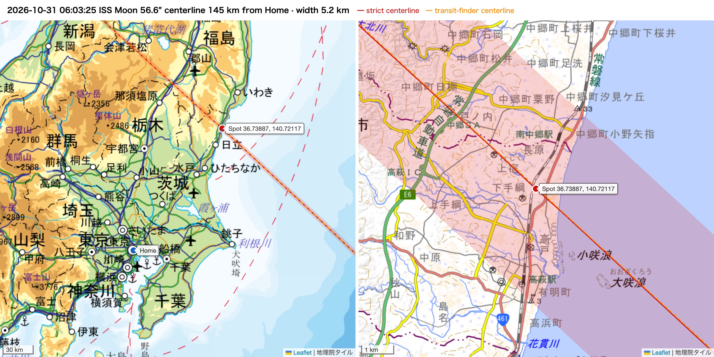
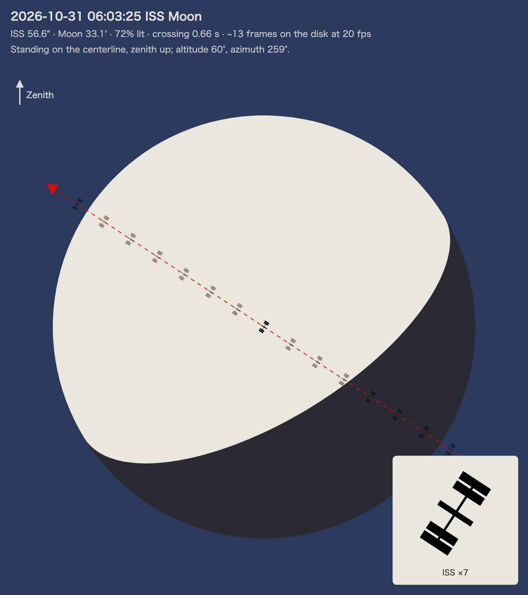
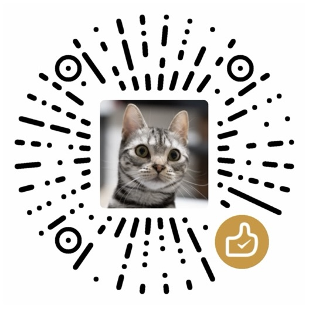

# transit-watch

[](LICENSE) [](https://github.com/sponsors/b-z)

[中文](docs/zh/README.md) · [日本語](docs/ja/README.md)

**Where to stand, and when, to photograph the ISS crossing the Sun or the Moon.**

transit-watch searches the next two weeks for transits of the ISS, the Tiangong space station and the Hubble Space Telescope across the Sun and the Moon near your home. For every transit worth shooting it tells you:

- **the spot**: the point of the centerline nearest to home *that is on land*, with the centerline recomputed for that spot's real elevation;
- **the time** to 0.01 s, the station's **apparent size** at that spot, the crossing time and the width of the visibility path;
- **the weather** for that spot and hour (clear, partly cloudy, overcast, rain);
- **two images**: a map of the centerline and a preview of the disk with the station drawn to scale, one silhouette per frame of your camera;
- **an interactive map** (one HTML file for all events): tap any point, or follow your phone's location, to see how far and which way the centerline is *at that point's real ground height*, whether you are inside the visibility path, and the center time there.

<p>

</p>
<p align="center">

</p>

The centerline is computed locally from public data (CelesTrak orbits, JPL ephemeris, IERS Earth orientation). No web service is scraped.

## Install

Python 3.11 or newer:

```bash
uv tool install git+https://github.com/b-z/transit-watch
# or: pipx install git+https://github.com/b-z/transit-watch
```

The images are rendered with headless Google Chrome or Chromium. Without a browser the text report is still written.

## Quick start

```bash
transit-watch init      # asks for your home coordinates, time zone, language and thresholds
transit-watch run       # prints the report and saves it with the images
```

`init` can also run without prompts:

```bash
transit-watch init -y --lat 35.6812 --lon 139.7671 --elevation 5 --timezone Asia/Tokyo --language en
```

Reports go to `~/transit-watch/reports/` as Markdown and JSON, with the images in a folder per day and the interactive map as `<date>-map.html`. Host the map over HTTPS (any static web server) if you want to use your phone's location on it. Run it once a day (cron, launchd, a scheduled task): orbits are only reliable a few days ahead, so check again on the day of the transit.

### With Claude Code

The repository is also a Claude Code plugin. Its skill handles the first-time setup, runs the forecast and summarizes it, and can set up a daily report.

```
/plugin marketplace add b-z/transit-watch
/plugin install transit-watch@transit-watch
```

Then ask, for example, "any ISS transits worth shooting this week?".

## Configuration

`~/.config/transit-watch/config.toml` (or the path in `TRANSIT_WATCH_CONFIG`). `transit-watch init` writes every option with its default.

| Key | Default | Meaning |
|---|---|---|
| `location.latitude`, `longitude`, `elevation_m`, `timezone` | — | Home. Distances are measured from here. |
| `search.days` | 14 | How far ahead to search. |
| `search.min_altitude_deg` | 15 | Ignore transits lower than this. |
| `search.satellites` | ISS, Tiangong, Hubble | NORAD numbers. The first one uses the `rules.iss` thresholds. |
| `rules.iss.sun` | 50″, 40 km | Minimum apparent size, maximum distance of the centerline from home. |
| `rules.iss.moon` | 30″, 160 km, 60% lit | The Moon is only worth it when it is full or gibbous. |
| `rules.other.sun` / `moon` | 8″ / 6″, same distances | Other spacecraft are much smaller. |
| `grades` | 60″ / 50″ / 30″ | Excellent / good / fair. An ISS transit near the zenith is about 60″. |
| `model.mode` | `strict` | `strict` or `transit-finder` (see below). |
| `model.compare_transit_finder` | true | Also show the other model's centerline. |
| `spot.land_provider` | `auto` | Elevation data for finding land: GSI in Japan, Open-Meteo elsewhere, or `none`. |
| `render.fps` | 20 | Camera frame rate used to space the silhouettes in the disk preview. |
| `render.chrome` | auto | Path to Chrome or Chromium. |
| `output.dir`, `output.language` | `~/transit-watch/reports`, `en` | Report folder; `en`, `zh` or `ja`. |

## How it works

At every instant, the observers who see the station exactly over the center of the Sun or the Moon lie on the line from the center of that body through the station, extended to the ground. As the station moves, that footprint draws the **centerline**. transit-watch finds where centerlines pass near home, then:

1. walks along the centerline from the point nearest home until it reaches land;
2. recomputes the centerline for that spot's height and solves for the point that lies on the centerline at its own ground height: at 40° altitude, 300 m of height moves the centerline about 360 m sideways. Heights are ellipsoidal: in Japan the GSI geoid model is added to the DEM elevation (about 37 m around Tokyo, which alone moves a centerline 20–45 m);
3. computes, *at that spot*, the instant of the central transit, the apparent size and speed of the station, the crossing time and the width of the visibility path;
4. asks Open-Meteo for the cloud cover and rain chance at that spot and hour.

Satellites are propagated with SGP4 from the latest CelesTrak TLEs. Sun and Moon positions come from JPL DE421 through skyfield.

## Accuracy

**Model.** The `strict` model uses IERS UT1, precession and nutation, light time and aberration. Its topocentric Sun and Moon positions agree with JPL Horizons to 0.05″, which is well under a meter on the ground.

**transit-finder mode.** [transit-finder.com](https://transit-finder.com) is the tool most transit photographers use. The `transit-finder` model reproduces its conventions; in an October 2026 comparison, its centerlines matched all 24 of that site's centerlines to about a meter. The main difference from `strict` is that the Moon is evaluated about 69 s late (UTC used as the ephemeris time scale), plus no aberration and no nutation for the Sun and Moon. Over 30 days of transits near Tokyo the two models differed by:

| | median | max |
|---|---|---|
| ISS × Sun | 54 m | 64 m |
| ISS × Moon | 73 m | 304 m |
| other × Sun | 39 m | 226 m |
| other × Moon | 107 m | 365 m |

**What limits you in practice is the orbit.** A TLE is a fit, and its prediction error grows with every day after its epoch, often by more than the difference above. Run the forecast again on the day of the transit and use the newest TLE.

## Data and credits

- Orbits: [CelesTrak](https://celestrak.org). Downloads are cached for 2 hours, as CelesTrak asks.
- Ephemeris: JPL DE421 via [skyfield](https://rhodesmill.org/skyfield/). Earth orientation: IERS Bulletin A from [USNO](https://maia.usno.navy.mil).
- Weather and elevation outside Japan: [Open-Meteo](https://open-meteo.com) (CC BY 4.0).
- Elevation and maps in Japan: [GSI tiles and DEM](https://maps.gsi.go.jp/development/ichiran.html) (地理院タイル). Maps elsewhere: Esri World Street Map. Maps are drawn with [Leaflet](https://leafletjs.com).

This is an independent project. It is not affiliated with transit-finder.com and does not access it.

## Support the project

transit-watch is maintained in spare time. If it helps you catch a transit, you can support it through [GitHub Sponsors](https://github.com/sponsors/b-z) or with WeChat. Sponsoring is entirely optional and does not affect how issues or pull requests are handled.

<table><tr>
<td align="center" valign="middle"><a href="https://github.com/sponsors/b-z"></a></td>
<td align="center" valign="middle"></td>
</tr></table>

## License

[GPL-3.0-or-later](LICENSE).
